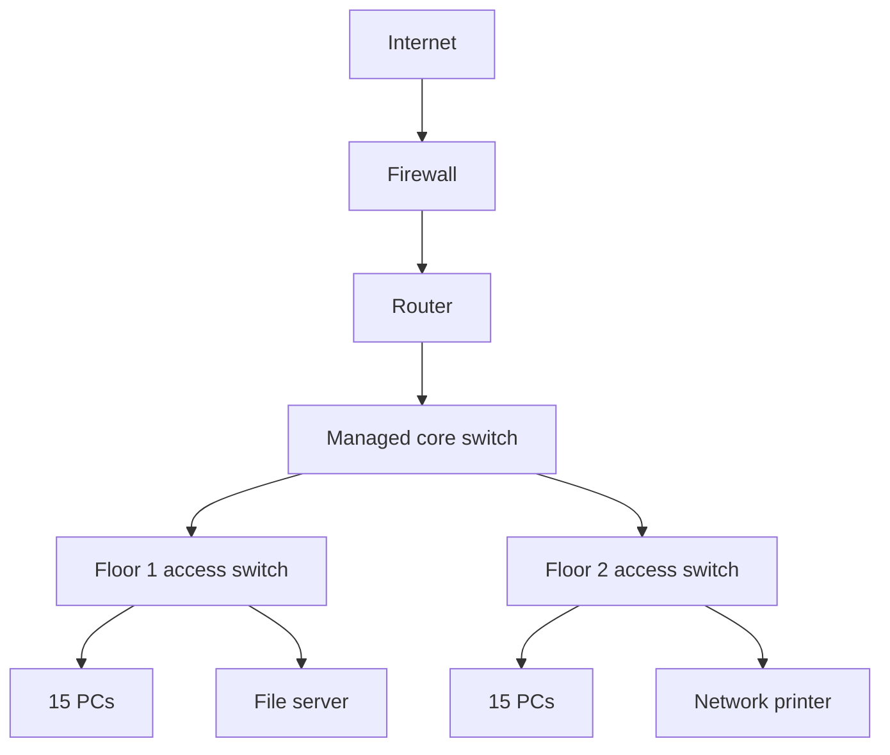

# Task 1 – Why Does the Whole Office Stop? (6 marks)

## Existing design and faults
A coaxial bus is one shared collision domain. A loose connector, damaged cable or missing terminator can interrupt the entire segment. A hub repeats every signal to all ports, so devices share bandwidth and collisions. The home router is a single point of failure and is not designed for a managed 30-user office. Month-end transfers compete for shared capacity. Bus wiring is difficult to expand and troubleshoot.

## Proposed extended star
Logical diagram (Mermaid):

Physical design: place a locked telecom cabinet on each floor; home-run Cat6/Cat6A from each desk to its floor switch; use fibre uplink between floors/core where practical; label both ends and use patch panels. Server connects directly to the core switch. Firewall sits between router and internal network.

## Bandwidth comparison (planning assumption)
The question gives no line rate. For a comparable illustration assume a 10 Mbps shared bus and a 1 Gbps switched access port per PC.
- Old bus: 10/30 = 0.333 Mbps average if all 30 share equally; actual throughput varies with collisions and traffic.
- New switched access: each PC has a dedicated 1 Gbps full-duplex switch port. If the core uplink is 10 Gbps and all 30 send simultaneously, the aggregate uplink share is 10,000/30 = 333 Mbps per PC. Server port/uplink capacity can be the bottleneck and should be sized accordingly.

## Wireless alternative
Assume one Wi-Fi 6 AP provides 600 Mbps of real aggregate throughput in the chosen environment. Equal share for 30 active clients is about 20 Mbps each, before airtime contention and protocol overhead. Wi-Fi 6 is useful for mobile devices, but a switched wired star is more predictable for large month-end file transfers.

## Defence (under 100 words)
Replacing the bus with an extended star prevents one desk move or cable fault from disabling every user. Switches provide dedicated full-duplex ports and reduce collisions. Structured cabling makes faults easier to isolate and expansion simpler. A business firewall and router replace the overloaded home router and improve security and reliability. A managed core switch and properly sized server uplink improve month-end file access. Wi-Fi can support mobile users, but fixed PCs and the file server should remain wired.
