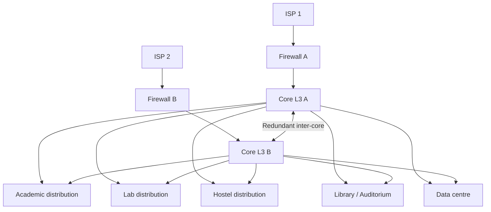

# Task 6 – New University Campus Network Design (13 marks)

## Stage 1 – planning estimates
The problem gives 600 lab computers and 3,000 hostel students but no detailed headcount. Planning assumptions:
- Academic: 1,000 users, 1,000 wired/managed endpoints plus Wi-Fi.
- Laboratories: 600 wired PCs.
- Library: 300 concurrent users.
- Hostels: 3,000 students; plan for 1,500 concurrent Wi-Fi clients at peak.
- Auditorium: 500 concurrent wireless users plus AV systems.
- Data centre: 40 servers/storage/network appliances.
Design target: 10-year growth of 30%; all buildings receive dual-path backbone where feasible; student, staff, guest and CCTV are isolated; two independent ISPs; critical services remain reachable after one core link fails.

## Stage 2 – hierarchical hybrid topology
Two core Layer-3 switches operate as a redundant pair. Each building has redundant fibre uplinks to the core/distribution layer; access switches connect endpoints in star. The data centre connects to both core switches. Dual ISP routers/firewalls connect to the core. Redundant links use LACP where supported and Rapid-PVST/MST or routed links with a suitable routing protocol. Avoid Layer-2 loops.

## Stage 3 – devices and technology
- Core/distribution: Layer-3 switches with 10/25/40/100G fibre uplinks as justified by traffic.
- Access: managed PoE+ switches for APs, phones and CCTV; non-PoE switches for PCs where appropriate.
- Media: Cat6A horizontal cabling; single-mode fibre between buildings for distance, future bandwidth and electrical isolation.
- Wireless: Wi-Fi 6/6E APs with controller/cloud management and a predictive + on-site RF survey.
- Security: next-generation firewalls, 802.1X for staff, guest captive portal, ACLs and separate CCTV VLAN.
- WAN: two ISPs with policy-based routing or dynamic routing and health checks.

## Stage 4 – addressing and capacity
Private aggregate: 10.40.0.0/16. Example VLAN plan:
| VLAN | Purpose | Subnet | Usable addresses |
|---:|---|---|---:|
| 10 | Staff | 10.40.0.0/22 | 1022 |
| 20 | Students | 10.40.4.0/20 | 4094 |
| 30 | Guest | 10.40.20.0/21 | 2046 |
| 40 | CCTV | 10.40.28.0/22 | 1022 |
| 50 | Labs | 10.40.32.0/22 | 1022 |
| 60 | Servers | 10.40.36.0/24 | 254 |
| 70 | Network management | 10.40.37.0/24 | 254 |
| 80 | Auditorium/AV | 10.40.38.0/23 | 510 |

The subnets are non-overlapping and fit inside 10.40.0.0/16. Expand with additional reserved blocks as buildings grow.

Example uplink sizing (planning targets, not measured traffic): each 48-port access switch has a 10G uplink; 4 access switches aggregate to a 40G distribution uplink (1:1). A building with 8 such access switches aggregates 80G of access capacity to 2×40G uplinks (1:1 aggregate). If only one 40G uplink is deployed, oversubscription is 2:1. Size actual uplinks using busy-hour telemetry.

## Stage 5 – reduced Packet Tracer validation
Build two core switches, two building access switches, a server, representative PCs, VLANs and two ISP/edge links. Test:
- Staff/student/guest/CCTV VLAN addressing and allowed/denied pings.
- Server reachability from permitted VLANs.
- Shut one core uplink and verify the alternate path remains operational.
- Disable ISP1 and confirm ISP2 provides external reachability if failover is configured.
Save the .pkt and screenshots in `evidence/`.

## Collapsed-core alternative
A collapsed core combines core and distribution, saving one distribution layer per building or reducing the number of high-capacity switches. But a single collapsed-core switch failure can disconnect all attached buildings and their services unless it is deployed as a redundant pair. For a 10-year university network, the saving is not worth a single-device campus-wide failure. A redundant collapsed-core pair may be a cost-effective initial phase for a smaller campus, provided it has redundant power, supervisors and diverse uplinks.
